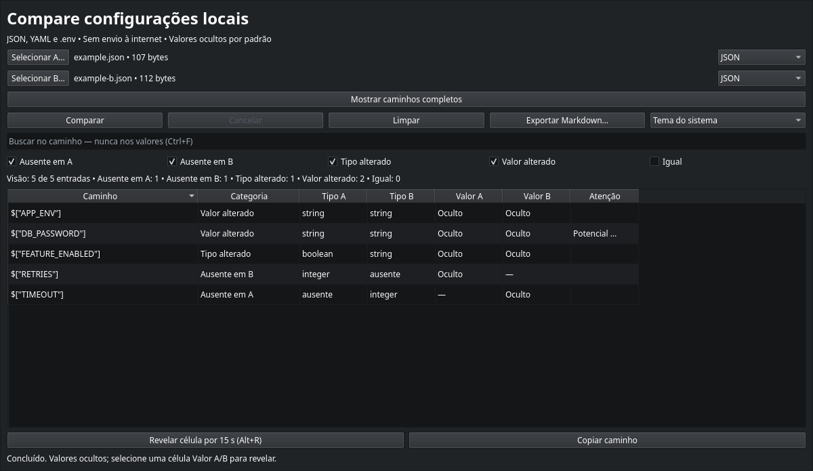

# Fase 4 — interface gráfica funcional

Incremento 0.0.5, em 22/10/2026. A janela demonstrativa foi substituída pelo fluxo real.
A prova antiga permanece em ui/probe_window.py, usada apenas pelos testes históricos.

## Usar

```sh
.venv/bin/configdiff
```

1. Selecione A e B. Para experimentar, use tests/fixtures/example.json e example-b.json.
2. Confirme o formato e clique Comparar. Nomes sem extensão reconhecida exigem seleção manual.
3. Use busca por caminho e marque as categorias que deseja ver. Contadores refletem a visão.
4. Para revelar, selecione uma célula Valor A/B e use Revelar célula ou Alt+R.
5. Exporte a visão atual para um arquivo Markdown novo; valores continuam omitidos.

Por padrão, só aparecem diferenças. Marque Igual para incluir entradas iguais.
Caminhos completos ficam em detalhe recolhível sob ação explícita. O título e a
mensagem de erro nunca incluem conteúdo dos arquivos. Não há editor ou cópia de valores.

Revelação dura até 15 s e mostra somente uma célula. Strings têm prévia de 512
caracteres, com controles e Unicode escapados; contêineres mostram apenas seu tipo,
sem revelar a subárvore inteira. Trocar seleção, arquivo, formato, ordenação, filtro,
perder foco, desativar a janela, cancelar ou limpar oculta a revelação. Esc oculta
imediatamente ou cancela o trabalho ativo. Ao revelar outra célula, a anterior é ocultada.

## Teclado e tamanho

| Atalho | Ação |
|---|---|
| Ctrl+O | Selecionar A |
| Ctrl+Shift+O | Selecionar B |
| Ctrl+Enter | Comparar |
| Ctrl+F | Buscar caminho |
| Ctrl+E | Exportar |
| Alt+R | Revelar célula Valor A/B selecionada |
| Esc | Cancelar ou ocultar |
| Ctrl+C no terminal | Encerrar com código 130 |

Tab percorre controles, setas navegam na tabela. Use Copiar caminho para a cópia
explícita; Ctrl+C na tabela não copia valores. A tabela é somente leitura, com colunas
redimensionáveis e ordenação por caminho, categoria e tipos; valores não são critério
de ordenação. Estados e indicador de possível segredo têm texto, sem depender de cor.

Tema do sistema é o padrão; opções claro/escuro ficam na barra de ações. A janela
usa fontes do sistema, nomes acessíveis e foco visível. Em área pequena, há rolagem
externa e rolagem da tabela para alcançar todos os controles. O teste de 200% é um
smoke automatizado; aceite de acessibilidade e escalas reais por Franklin segue pendente.

## Preferências

QSettings em IniFormat, escopo do usuário, FranklinMartins/ConfigDiff. São gravados
somente esquema, tema, largura, altura e formato preferido. Valores inválidos retornam
aos padrões; gravação usa sincronização atômica e lista fechada de campos. Nenhum nome,
caminho, conteúdo, resultado ou busca é gravado nessas preferências. Arquivos conhecidos
ainda têm formato detectado por extensão; formatos desconhecidos exigem escolha explícita.

## Evidências

Os testes cobrem fluxo gráfico com worker real, seleção por diálogos controlados,
filtros, contadores, exportação da visão e rejeição da origem, erro em B sem resultado
anterior, formato ambíguo/incompatível, timeout, cancelamento e fechamento sem filho vivo.
Revelação é testada por célula, timer, foco, desativação, troca de seleção/arquivo/formato,
ordenação, filtros, Esc e limpar. ToolTipRole/EditRole não entregam valores. Testes também
verificam atalhos, rolagem, texto de nome de arquivo sem rich text e preferências sem sentinelas.

Uma regressão final encontrou SIGINT atingindo o bootstrap Python do filho antes do
handler. Corrigido no transporte POSIX: bloqueia SIGINT durante spawn, o filho herda
a máscara, e o pai restaura a sua, recebendo sinais pendentes. A regressão passou a
enviar SIGINT ao grupo imediatamente após criar o trabalho, sem espera artificial.
Windows não tem essa máscara POSIX e ainda requer validação nativa.

| Verificação final | Resultado |
|---|---|
| Ruff lint/formatação e mypy | Passaram; 33 arquivos de src na tipagem |
| pytest headless completo | 226 testes passaram em 28,89 s |
| Regressão SIGINT após correção, ocioso/ativo | 2 testes passaram; grupo recebe sinal sem espera artificial |
| Janela fonte em Wayland | Smoke passou; captura inspecionada com valores ocultos |
| PyInstaller onedir limpo | Build Linux concluído |
| Pacote em Wayland | Comparação/mascaramento/exportação/cancelamento passaram |
| Pacote offscreen com QT_SCALE_FACTOR=2 | Smoke passou |
| SIGINT imediato no grupo do pacote | Código 130, sem traceback e sem subprocessos remanescentes |

A captura abaixo usa somente o par fictício distribuído:



Artefatos locais: dist/ConfigDiff/ConfigDiff, dist/configdiff-phase4-linux-x86_64.tar.gz
e dist/SHA256SUMS. Não equivalem a release validada em máquina limpa.

## Distribuição e pendências

A versão ainda é 0.0.5 experimental, sem declaração de v0.1.0 pronta. Próxima fase:
inventário/avisos de dependências, pacote com documentação, validação em máquina limpa,
aceite manual, checksums e Windows. Nenhum repositório remoto ou release foi publicado.
O --smoke-test usa preferências e dados sintéticos em diretório temporário, sem tocar
nas preferências pessoais; verifica comparação, mascaramento, exportação e cancelamento.
